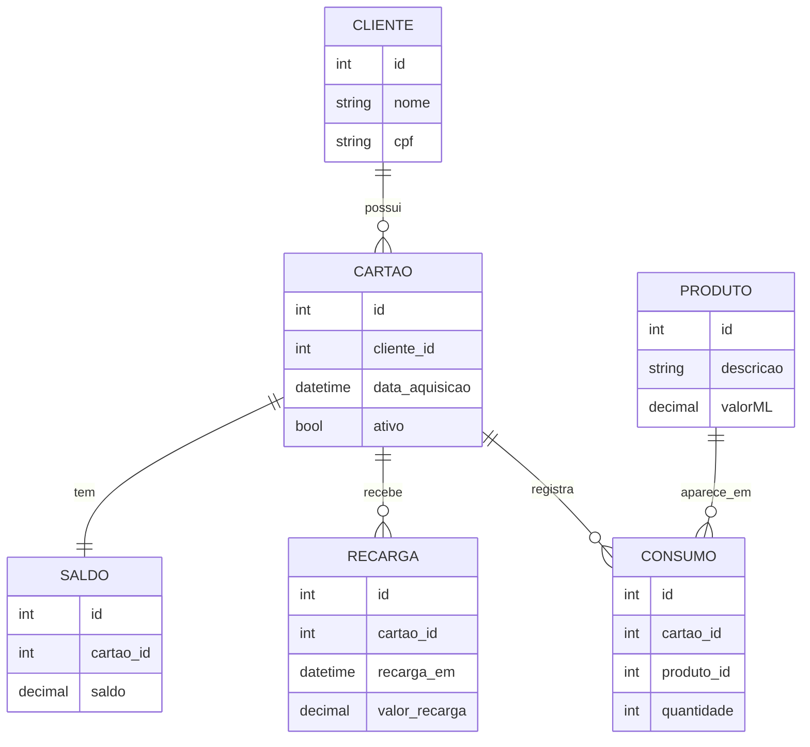

# Boteco API, chopeira self-service

API REST em Python, com Flask e SQLAlchemy, para uma chopeira self-service. O cliente recebe um cartão, faz recargas e se serve sozinho, e o sistema debita do saldo o preço por mililitro do chope consumido. A primeira versão foi um exercício feito em turma no curso Python para Inteligência Artificial do Entra21 (Blusoft e ACATE), em 2026. Nesta versão, corrigi os erros que encontrei, escrevi 27 testes automatizados da API com Pytest e configurei Docker e integração contínua no GitHub Actions.

> **English:** REST API in Python (Flask and SQLAlchemy) for a self-service beer tap, with customers, prepaid cards, top-ups, per-millilitre pricing and balance control. Started as a class exercise at Entra21. In this version I fixed the bugs I found, wrote 27 automated API tests with Pytest, and added Docker and GitHub Actions CI.

## Arquitetura

```
cliente HTTP (chopeira, caixa)
        │  JSON
        ▼
backend/apis/api.py      rotas, validação da entrada e respostas 400/404
        │
        ▼
clientes.py · cartoes.py · recargas.py · produtos.py · consumos.py · saldo.py
        │  regras de negócio
        ▼
models.py (SQLAlchemy 2.0)
        │
        ▼
SQLite (padrão)  ou  PostgreSQL (DATABASE_URL)
```

## Como funciona

### 1. Modelo de dados



### 2. Regras de negócio

- Todo cartão novo nasce ativo e com saldo zero.
- Recarga e consumo só valem para cartão ativo.
- O valor do consumo é o preço por ml vezes a quantidade em ml, arredondado ao centavo.
- Um consumo maior que o saldo é recusado, e o saldo não muda.
- Valores de dinheiro passam por `Decimal`, nunca por `float`, para não acumular erro de arredondamento.

### 3. API REST

| Método | Rota | Corpo (JSON) | Resposta |
|---|---|---|---|
| POST | `/api/cadastrar-cliente` | `nome`, `cpf` | 201 com o `id` |
| PUT | `/api/alterar-nome-cliente` | `id`, `nome` | 200 |
| POST | `/api/cadastrar-cartao` | `cliente_id` | 201 com o `id` |
| PUT | `/api/alterar-ativo` | `cartao_id`, `ativo` | 200 |
| POST | `/api/recarregar-cartao` | `cartao_id`, `valor` | 201 com o `id` |
| GET | `/api/saldo/<cartao_id>` | | 200 com o saldo |
| POST | `/api/cadastrar-produto` | `descricao`, `preco` (por ml) | 201 com o `id` |
| PATCH | `/api/alterar-produto` | `produto_id`, `descricao` e/ou `preco` | 200 |
| POST | `/api/registrar-consumo` | `cartao_id`, `produto_id`, `quantidade` (ml) | 201 com o `id` |

Dados inválidos retornam **400** e registros inexistentes retornam **404**, sempre com uma mensagem em `error`.

Exemplo, uma recarga de R$ 50 e um chope de 500 ml a R$ 0,035 por ml:

```
POST /api/recarregar-cartao     {"cartao_id": 1, "valor": 50}
POST /api/registrar-consumo     {"cartao_id": 1, "produto_id": 1, "quantidade": 500}
GET  /api/saldo/1               →  {"cartao_id": 1, "saldo": "32.50"}
```

## Como rodar

Requer Python 3.10 ou mais novo.

1. Crie e ative um ambiente virtual.

```
python -m venv venv
source venv/bin/activate        # no Windows: venv\Scripts\activate
```

2. Instale as dependências.

```
pip install -r requirements.txt
```

3. Sem configuração, a API usa um arquivo SQLite local (`boteco.db`). Para usar PostgreSQL, veja a seção abaixo.

4. Rode a API, que fica em http://127.0.0.1:5000.

```
python main.py
```

### Com Docker

```
docker build -t boteco-api .
docker run -p 5000:5000 boteco-api
```

### Com PostgreSQL

Instale `psycopg2-binary` e defina `DATABASE_URL` num arquivo `.env`, seguindo o `.env.example`. Funciona, por exemplo, com um banco no Neon.

## Testes

```
pip install -r requirements-dev.txt
pytest -v
```

São 27 testes, que sobem a API com um banco SQLite novo em memória a cada teste e fazem as requisições pelo cliente de testes do Flask. Eles cobrem cadastro e validação de clientes, cartões e produtos, recargas, consumos, arredondamento, saldo insuficiente, cartão desativado e respostas 400 e 404. O GitHub Actions roda todos a cada push.

## Estrutura

```
boteco-api/
├── backend/
│   ├── apis/api.py       # rotas, tratamento de erros e create_app()
│   ├── connection.py     # conexão com SQLite ou PostgreSQL
│   ├── models.py         # tabelas (SQLAlchemy 2.0)
│   ├── clientes.py       # regras de cada entidade
│   ├── cartoes.py
│   ├── saldo.py
│   ├── recargas.py
│   ├── produtos.py
│   ├── consumos.py
│   └── erros.py
├── tests/                # testes da API com Pytest
├── .github/workflows/    # integração contínua
├── Dockerfile
└── main.py
```

## O que eu faria diferente hoje

Ao revisar o exercício, corrigi os seguintes problemas.
- A recarga pela API dava erro, porque somava o valor recebido como `float` a um saldo em `Decimal`.
- A recarga conferia se o cartão estava ativo antes de conferir se ele existia, e quebrava com um cartão inexistente.
- O banco só funcionava com PostgreSQL na nuvem, embora o README dissesse SQLite. Agora o SQLite é o padrão e o PostgreSQL é opcional.
- As sessões do banco não eram fechadas, as alterações respondiam 201 em vez de 200 e os erros escondiam o motivo.
- Não havia nenhum teste.

O que ainda melhoraria:
- **Rotas no padrão REST.** Recursos no plural e o método HTTP dizendo a ação, como `POST /api/clientes` e `PATCH /api/cartoes/1`, em vez de verbos na URL.
- **Concorrência no saldo.** Dois consumos ao mesmo tempo no mesmo cartão podem ler o mesmo saldo. Em PostgreSQL, eu travaria a linha do saldo durante a operação (`SELECT ... FOR UPDATE`).
- **Validação do CPF**, conferindo os dígitos verificadores.
- **Autenticação**, para que só a chopeira e o caixa possam registrar consumos e recargas.
- **Migrações com Alembic**, em vez de criar as tabelas direto no código.
- **Consultas**, como extrato de recargas e consumos de cada cartão.

---

Exercício feito em turma no Entra21. Esta versão é mantida por **Isadora Fernanda Zappe Schmidt** · [LinkedIn](https://www.linkedin.com/in/isadora-fernanda)
